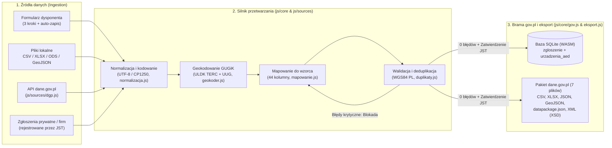

<div align="center">


# Namiar na Puls (Projekt Misja-AED)

**Mapa. Puls. Namiar.**

*Urzędowo weryfikowany system agregacji, standaryzacji, deduplikacji geoprzestrzennej i publikacji danych o defibrylatorach AED dla ekosystemu `gov.pl` oraz `dane.gov.pl`.*

Link do uruchomienia strony: https://namiarnapuls.vercel.app/#start

[-009A3B?style=flat-square)](#6-model-danych-44-kolumny-i-schemat-sqlite)
[](#5-silnik-przetwarzania-danych-i-moduły-aplikacji)
[-0E5B2B?style=flat-square)](#6-model-danych-44-kolumny-i-schemat-sqlite)
[](#7-struktura-repozytorium-uruchomienie-i-testy)
[](#7-struktura-repozytorium-uruchomienie-i-testy)

<br />

[Prezentacja UI](#3-prezentacja-interfejsu-i-zrzuty-ekranu) •
[Architektura](#4-architektura-systemu-i-stos-technologiczny) •
[Pipeline Danych](#5-silnik-przetwarzania-danych-i-moduły-aplikacji) •
[Model 44 Kolumn](#6-model-danych-44-kolumny-i-schemat-sqlite) •
[Uruchomienie i Testy](#7-struktura-repozytorium-uruchomienie-i-testy) •
[Księga Znaku](#9-identyfikacja-wizualna-govpl-i-księga-znaku)

</div>

---

## 1. Streszczenie wykonawcze (Executive Summary)

Przy **nagłym zatrzymaniu krążenia (NZK)** o przeżyciu poszkodowanego decydują pierwsze minuty, a kluczowym ogniwem łańcucha przeżycia jest natychmiastowe użycie sprawnego automatycznego defibrylatora zewnętrznego (**AED**). W Polsce dane o lokalizacji urządzeń są rozproszone pomiędzy urzędami gmin, szkołami, jednostkami Ochotniczych Straży Pożarnych (OSP), podmiotami prywatnymi oraz niejednorodnymi arkuszami publikowanymi w sieci.

Brak jednolitego standardu wymiany i kontroli prowadzi w praktyce do krytycznych błędów: zamiany szerokości z długością geograficzną, duplikowania punktów przy kolejnych importach, nieaktualnych godzin dostępu lub ponownego pojawiania się urządzeń wycofanych z eksploatacji. **Namiar na Puls** rozwiązuje ten problem, dostarczając spójny, urzędowo weryfikowany proces obiegu informacji:

1. **Warstwa pozyskiwania i normalizacji:** Umożliwia zarówno intuicyjne zgłaszanie punktów przez dysponentów (w 3-krokowym formularzu webowym lub szablonach offline `XLSX`/`CSV`), jak i masowe scalanie rozproszonych plików (`CSV`, `XLSX`, `XLS`, `ODS`, `JSON`, `GeoJSON`) oraz bezpośredni pobór istniejących zasobów z API `dane.gov.pl`.
2. **Warstwa kontroli jakości i autoryzacji JST:** Automatyczny silnik reguł geoprzestrzennych (kontrola granic Polski w układzie WGS84, wykrywanie zamiany `lat`/`lon`, walidacja identyfikatorów TERYT/TERC przez usługi GUGiK ULDK/UUG oraz deduplikacja) **blokuje przesył wadliwych rekordów**, a ostateczne zatwierdzenie i wysyłka na serwery `gov.pl` realizowane są przez zweryfikowaną jednostkę samorządu terytorialnego (urząd / gminę).

| Atrybut projektu | Specyfikacja |
| :--- | :--- |
| **Nazwa systemu** | Namiar na Puls (Projekt *Misja-AED*) |
| **Zespół inżynieryjny** | **wsizENJOYERS** (2026) |
| **Repozytoria źródłowe** | [`kamilkowalskiii/Namiar-na-puls`](https://github.com/kamilkowalskiii/Namiar-na-puls) • [`xkolosek-lab/Misja-AED`](https://github.com/xkolosek-lab/Misja-AED) |
| **Docelowi interesariusze** | Jednostki Samorządu Terytorialnego (urzędy miast i gmin), koordynatorzy regionalni (urzędy wojewódzkie, ministerstwa), dysponenci sprzętu (szkoły, OSP, instytucje, firmy) oraz mieszkańcy |
| **Zgodność ze standardami** | *Standard techniczny dane.gov.pl (2020)* (44 kolumny), GeoJSON (`RFC 7946` / `EPSG:4326`), Frictionless Data (`datapackage.json`), Harvester XML (`otwarte_dane_latest.xsd`), SQLite 3 |
| **Model wdrożenia** | Zero-build SPA (ES6+ Modules) + WebAssembly SQLite (`sql.js`) + lokalny serwer Python (`serwer.py`) + CI/CD GitHub Pages |

---

## 2. Kluczowe przewagi architektoniczne i biznesowe

* **Architektura *Air-Gapped Ready* (Zero zewnętrznych zależności CDN):**
  Wszystkie biblioteki uruchomieniowe (`Leaflet`, `SheetJS`, `PapaParse`, `SQL.js WASM`, kroje pisma `Open Sans`) są wbudowane lokalnie w katalogu `vendor/`. Aplikacja działa w odizolowanych sieciach urzędowych bez zewnętrznych zapytań o skrypty i gwarantuje pełną prywatność przetwarzanych danych roboczych.
* **Relacyjna baza SQLite działająca bezpośrednio w przeglądarce (WebAssembly):**
  Dzięki integracji silnika `sql.js` (`vendor/sqljs/sql-wasm.wasm`) oraz modułu `js/core/gov.js`, aplikacja wykonuje pełne transakcje SQL (`BEGIN; INSERT INTO ... COMMIT;`) na ustrukturyzowanym schemacie `gov_schemat.sql` bez konieczności utrzymywania ciężkiej infrastruktury serwerowej po stronie urzędu gminy.
* **Dwupoziomowa ochrona integralności rejestru państwowego:**
  System chroni bazę `gov.pl` przed zanieczyszczeniem danymi na poziomie **technicznym** (twarda blokada eksportu przy błędach krytycznych współrzędnych lub braku pól obowiązkowych) oraz **instytucjonalnym** (weryfikacja merytoryczna przez pracownika urzędu/gminy, który może wpisać do ewidencji również prywatne AED zgłoszone przez lokalne sklepy czy mieszkańców).
* **Dostępność cyfrowa (WCAG) i ergonomia pracy w administracji:**
  Interfejs wzorowany na standardzie `gov.pl` został zaprojektowany tak, aby nawet osoby bez specjalistycznego przeszkolenia IT mogły bez trudu zaktualizować wykaz gminny. Wspiera pełną nawigację klawiaturą (w tym obsługę mapy klawiszami `Tab`, strzałkami oraz `+`/`-`), automatyczny lokalny zapis szkicu formularza w przeglądarce oraz automatyczne testy dostępności przy użyciu `axe-core`.

---

## 3. Prezentacja interfejsu i zrzuty ekranu

Poniższa dokumentacja wizualna prezentuje kompletny przepływ pracy w aplikacji — od ekranu głównego i formularza dysponenta, przez 4-etapowy kreator scalania i mapę GUGiK, aż po eksport paczki `dane.gov.pl` oraz transakcyjny zapis w bazie SQLite.

### 3.1. Ekran startowy oraz Formularz dysponenta AED

| Ekran główny aplikacji (`index.html`) | Formularz dysponenta AED (3 kroki + auto-zapis) |
| :---: | :---: |
|  |  |
| *Dwie główne ścieżki pracy: „Scal dane z wielu źródeł” dla koordynatorów JST oraz „Udostępnij dane o swoich AED” dla dysponentów (online lub szablon Excel/CSV).* | *3-etapowy kreator (`1. Instytucja`, `2. Urządzenia`, `3. Przekaż dane`) z lokalnym auto-zapisem szkicu w przeglądarce, wyborem licencji (`CC0 1.0` / `CC BY 4.0`) i funkcją duplikowania urządzeń w jednym budynku.* |

### 3.2. Kreator scalania i kontroli jakości danych (Kroki 1–3)

| Krok 1 z 4: Wybór źródeł danych | Krok 2 z 4: Automatyczne mapowanie kolumn |
| :---: | :---: |
|  |  |
| *Import metodą przeciągnij i upuść plików `CSV`, `XLSX`, `XLS`, `ODS`, `JSON` i `GeoJSON` z automatycznym rozpoznawaniem kodowania znaków, separatora i priorytetu w Rejestrze źródeł.* | *Heurystyczne dopasowanie nagłówków wejściowych do 44 pól wzorca ze wskaźnikiem pewności dopasowania, filtrami pól obowiązkowych/niedopasowanych oraz podglądem wartości po normalizacji.* |

### 3.3. Walidacja geoprzestrzenna oraz Mapa punktów GUGiK (Kroki 3–4)

| Krok 3 z 4: Walidacja, deduplikacja i poprawki zbiorcze | Krok 4 z 4: Interaktywna mapa punktów (Leaflet + GUGiK) |
| :---: | :---: |
|  |  |
| *Wykrywanie błędów krytycznych blokujących wysyłkę, sygnalizacja ostrzeżeń adresowych oraz poprawki zbiorcze („Wpisz jedną wartość...”) dla wielu rekordów jednocześnie.* | *Weryfikacja rozmieszczenia punktów na mapie topograficznej i ortofotomapie z warstwą punktów adresowych i ulic, kolorowaniem według statusu oraz pełną obsługą z klawiatury.* |

### 3.4. Integracja z bazą SQLite / gov.pl oraz Wzorzec 44 kolumn

| Brama wysyłki na gov.pl i pakiet 7 plików wyjściowych | Transakcyjny zrzut SQLite (`gov_schemat.sql`) |
| :---: | :---: |
|  |  |
| *Zatwierdzenie zbioru przyciskiem „Wyślij do zatwierdzenia przez bazę gov.pl” oraz generowanie w przeglądarce kompletu plików zgodnych z wymogami harvesterów `dane.gov.pl`.* | *Rzeczywista struktura transakcji SQL (`BEGIN; INSERT INTO zgloszenie... INSERT INTO urzadzenia_aed...`) zapisywana w bazie SQLite i eksportowana do weryfikacji w pliku `.txt`.* |

### 3.5. Specyfikacja wzorca danych oraz materiały wdrożeniowe dla JST

| Specyfikacja wzorca 44 kolumn (`wzorzec/`) | Poradnik wdrożeniowy dla urzędów i gmin |
| :---: | :---: |
|  |  |
| *Wielozakładkowy skoroszyt referencyjny zawierający słownik pól, słowniki wartości dopuszczalnych, reguły walidacji oraz uzasadnienie ratownicze każdej kolumny.* | *3-etapowa instrukcja wdrożeniowa krok po kroku przygotowana dla upoważnionych pracowników urzędów miast i gmin.* |

---

## 4. Architektura systemu i stos technologiczny

### 4.1. Przepływ danych (End-to-End Data Pipeline)



### 4.2. Ścieżki użytkowników (Procesy biznesowe)

1. **Ścieżka A — Zweryfikowany podmiot publiczny (Urząd Miasta / Gmina / Koordynator regionalny):**
   * **Autoryzacja instytucji:** Upoważniony pracownik zweryfikowanego urzędu loguje się do panelu swojej jednostki z poziomu `gov.pl`.
   * **Odbiór i agregacja zgłoszeń:** Urzędnik przegląda nowe zgłoszenia z terenu gminy, dodaje urządzenia gminne w formularzu lub scala rejestry szkół, OSP i instytucji w 4-krokowym kreatorze.
   * **Weryfikacja merytoryczna:** Potwierdzenie lokalizacji na mapie topograficznej/ortofotomapie oraz doprecyzowanie opisu miejsca montażu (np. *kapsuła zewnętrzna przy wejściu*, *hol na parterze*).
   * **Walidacja i wysyłka na `gov.pl`:** Automatyczna kontrola kompletności metadanych, usunięcie duplikatów i zapis paczki w bazie centralnej wraz z potwierdzeniem synchronizacji.

2. **Ścieżka B — Partycypacja społeczna i sektor prywatny (Mieszkańcy / Sklepy / Firmy):**
   * **Zgłoszenie do urzędu:** Właściciel prywatnego defibrylatora (np. lokalny sklep, galeria handlowa, zakład pracy) zgłasza urządzenie bezpośrednio do właściwego urzędu lub gminy.
   * **Rejestracja posiadacza:** Urząd weryfikuje punkt i wpisuje w systemie osobę prywatną lub firmę jako oficjalnego **posiadacza urządzenia**.
   * **Publikacja centralna:** Zatwierdzony wpis trafia w standardowym obiegu na serwery `gov.pl`, zwiększając gęstość bezpiecznej sieci ratowniczej w gminie.

### 4.3. Stos technologiczny (Technology Stack)

| Warstwa | Technologia / Biblioteka | Rola w architekturze |
| :--- | :--- | :--- |
| **Frontend Core** | Vanilla JavaScript (ES6+ Modules), HTML5, CSS3 (RWD) | Lekka aplikacja SPA bez narzutu frameworków i etapu budowania (*zero-build*). |
| **Silnik SQL w przeglądarce** | `sql.js` (`vendor/sqljs/sql-wasm.wasm`) | Pełna relacyjna baza danych SQLite 3 uruchamiana po stronie klienta w WebAssembly. |
| **Mapy i GIS** | `Leaflet` (`vendor/leaflet/`) + usługi **GUGiK** (**ULDK**, **UUG**) | Wizualizacja punktów WGS84, podkłady topograficzne i ortofotomapy, geokodowanie adresów i kodów `TERC`. |
| **Przetwarzanie arkuszy** | `SheetJS` (`xlsx.full.min.js`), `PapaParse` (`papaparse.min.js`) | Parsowanie i generowanie skoroszytów `XLSX`, `XLS`, `ODS` oraz strumieniowe parsowanie `CSV` z detekcją kodowania. |
| **Narzędzia i Backend** | Python 3 (`serwer.py`, `wzorzec/generuj_wzorzec.py`) | Lokalny serwer HTTP/API, generator wzorca 44 kolumn oraz walidator schematu `otwarte_dane_latest.xsd`. |
| **Jakość i CI/CD** | Node.js, Chrome DevTools Protocol (`cdp.js`), `axe-core`, GitHub Actions | Automatyczne testy jednostkowe, testy integracyjne z mockami API, testy E2E przeglądarkowe, audyt WCAG oraz wdrożenie na GitHub Pages. |

---

## 5. Silnik przetwarzania danych i moduły aplikacji

Logika biznesowa została odseparowana od warstwy interfejsu użytkownika (`js/ui/`) i zorganizowana w modularnej przestrzeni nazw (`js/core/ns.js`):

| Warstwa / Moduł | Plik w repozytorium | Odpowiedzialność inżynieryjna |
| :--- | :--- | :--- |
| **Parser wieloformatowy** | `js/sources/file.js` | Obsługa `CSV`, `XLSX`, `XLS`, `ODS`, `JSON` i `GeoJSON` metodą *drag & drop*. Automatyczna detekcja kodowania znaków (w tym `Windows-1250` z arkuszy urzędowych), separatora kolumn i wiersza nagłówka. |
| **Konektor `dane.gov.pl`** | `js/sources/dgp.js` | Wyszukiwanie i pobieranie istniejących zbiorów oraz zasobów bezpośrednio z otwartego API portalu `dane.gov.pl` w celu ich aktualizacji i scalenia. |
| **Geokoder GUGiK (ULDK/UUG)** | `js/sources/geokoder.js` | Integracja z usługami państwowymi **ULDK** (pobieranie identyfikatorów jednostek terytorialnych `TERC` na podstawie współrzędnych) oraz **UUG** (geokodowanie adresów i geokodowanie odwrotne z obsługą ograniczeń WAF). |
| **Mapowanie heurystyczne** | `js/core/mapowanie.js` | Automatyczne dopasowywanie dowolnych nagłówków wejściowych do 44-kolumnowego wzorca wraz ze wskaźnikiem pewności dopasowania (*pewność wysoka/średnia/niska*). |
| **Normalizacja wartości** | `js/core/normalizacja.js` | Ujednolicanie formatów dat ISO, konwersja przecinków dziesiętnych na kropki we współrzędnych, mapowanie wartości słownikowych (`status`, `dostepnosc`, `sposob_dostepu`, `typ_urzadzenia`). |
| **Walidator reguł** | `js/core/walidacja.js` | Weryfikacja 11 pól obowiązkowych, kontrola granic Polski w układzie WGS84 (`lat`: $49.0\text{–}54.9$, `lon`: $14.1\text{–}24.2$), detekcja odwróconych współrzędnych (`lat`/`lon`) oraz ostrzeżenia o niespójnościach adresowych. |
| **Silnik deduplikacji** | `js/core/duplikaty.js` | Wykrywanie i scalanie duplikatów na podstawie klucza `dysponent + id_lokalne`, analizy bliskości przestrzennej oraz priorytetu źródeł zdefiniowanego przez koordynatora. |
| **Generator eksportu** | `js/core/eksport.js` | Generowanie w przeglądarce pakietu 7 plików wyjściowych (`CSV UTF-8`, `CSV BOM`, `XLSX`, `JSON`, `GeoJSON`, `datapackage.json`, `Metadane XML` zgodne z `otwarte_dane_latest.xsd`). |
| **Brama SQLite / `gov.pl`** | `js/core/gov.js`, `js/core/gov_schemat.sql` | Inicjalizacja bazy SQLite w pamięci WASM, transakcyjny zapis zgłoszeń i urządzeń oraz generowanie czytelnego zrzutu SQL `.txt`. |
| **Schemat i słowniki** | `js/schema/schema.js` | Pełna definicja 44 kolumn, reguł walidacyjnych, wyrażeń regularnych oraz zamkniętych słowników wartości dla całej aplikacji. |

---

## 6. Model danych 44 kolumny i schemat SQLite

### 6.1. Struktura wzorca danych (`wzorzec/schema.json`)

Model danych został zaprojektowany na podstawie **Standardu technicznego dane.gov.pl (2020)** oraz specyfikacji **GeoJSON (`RFC 7946`)**. Pełny rekord opisuje pojedynczy defibrylator za pomocą **44 ustandaryzowanych kolumn** podzielonych na 5 grup tematycznych:

| Grupa pól | Kluczowe kolumny wzorca | Reguły walidacji i cel ratowniczy |
| :--- | :--- | :--- |
| **1. Identyfikacja i cykl życia** | `id_aed`, `id_lokalne`, `nazwa`, `status` | Unikalny `UUID` w zbiorze; para `dysponent + id_lokalne` eliminuje duplikaty; wycofane AED otrzymują status `wycofany` zamiast usunięcia, co zapobiega ich powrotowi przy kolejnych scaleniach. |
| **2. Lokalizacja i adresacja** | `szerokosc_geograficzna`, `dlugosc_geograficzna`, `lokalizacja_przyblizona`, `zrodlo_wspolrzednych`, `kod_terc_gminy`, `wojewodztwo`, `miejscowosc`, `kod_simc`, `cecha_ulicy`, `ulica`, `kod_ulic`, `numer_budynku`, `kod_pocztowy` | Współrzędne `WGS84` z kropką dziesiętną w granicach Polski; flaga `lokalizacja_przyblizona` informuje ratownika, czy ufać pinezce GPS, czy szukać urządzenia wewnątrz budynku. |
| **3. Dostępność i opis miejsca** | `opis_lokalizacji`, `opis_lokalizacji_en`, `wewnatrz_budynku`, `kondygnacja`, `dostepnosc`, `godziny_dostepnosci`, `sposob_dostepu`, `instrukcja_dostepu` | Dwujęzyczny opis (`PL`/`EN`) dokładnego miejsca montażu (np. *kapsuła zewnętrzna*, *szafka z alarmem bez kodu/klucza*) oraz dostępności (np. `publiczna_24_7`). |
| **4. Parametry sprzętu i serwis** | `typ_urzadzenia`, `producent`, `model`, `tryb_pediatryczny`, `data_waznosci_elektrod`, `data_waznosci_baterii`, `data_przegladu` | Informacja o trybie półautomatycznym/automatycznym, obsłudze dzieci oraz terminach ważności materiałów eksploatacyjnych kluczowych dla gotowości bojowej AED. |
| **5. Dysponent i audyt weryfikacji** | `dysponent_nazwa`, `dysponent_typ`, `dysponent_regon`, `telefon_kontaktowy`, `email_kontaktowy`, `data_weryfikacji`, `sposob_weryfikacji`, `zrodlo_danych`, `zrodlo_id_rekordu`, `licencja_rekordu`, `data_aktualizacji_rekordu`, `uwagi` | Pełna rozliczalność pochodzenia rekordu (np. `jst`, `wizja_lokalna`, numer REGON, telefon do sekretariatu/portierni) oraz licencja otwartych danych (`CC0 1.0` lub `CC BY 4.0`). |

### 6.2. Komplet 7 plików wyjściowych generowanych w przeglądarce

Z poziomu Kroku 4 użytkownik może pobrać gotowy pakiet publikacyjny dla portalu `dane.gov.pl`:
1. **`CSV (UTF-8)`** — zalecany format główny do bezpośredniego wgrania w portalu `dane.gov.pl` (dodatkowo wariant **CSV z BOM** dla poprawnego kodowania polskich znaków w MS Excel).
2. **`XLSX (Excel)`** — skoroszyt do przeglądania i korekt w arkuszach kalkulacyjnych.
3. **`JSON`** — ustrukturyzowany zbiór danych dla programistów i zewnętrznych systemów.
4. **`GeoJSON` (`RFC 7946`)** — warstwa przestrzenna punktów ze współrzędnymi gotowa do otwarcia w QGIS, uMap lub systemach dyspozytorskich.
5. **`Rejestr źródeł (CSV)`** — zestawienie źródeł wejściowych, ich licencji oraz liczby rekordów wchodzących w skład scalonego zbioru.
6. **`datapackage.json`** — deskryptor zbioru i schematu kolumn w standardzie **Frictionless Data**.
7. **`Metadane XML (harvester)`** — plik metadanych zgodny ze schematem `otwarte_dane_latest.xsd` umożliwiający automatyczne pobieranie zbioru przez harvester `dane.gov.pl`.

### 6.3. Schemat transakcji SQLite (`js/core/gov_schemat.sql`)

```sql
BEGIN;

INSERT INTO zgloszenie (numer, data_wyslania, tytul, dysponent, licencja, liczba_urzadzen)
VALUES ('GOV-2026-000001', '2026-11-22T08:34:13', 'Defibrylatory AED Polska', NULL, 'CC-BY-4.0', 5);

INSERT INTO urzadzenia_aed (
  zgloszenie_numer, id_aed, id_lokalne, nazwa, status,
  szerokosc_geograficzna, dlugosc_geograficzna, lokalizacja_przyblizona, zrodlo_wspolrzednych,
  kod_terc_gminy, wojewodztwo, miejscowosc, kod_simc, cecha_ulicy, ulica, kod_ulic, numer_budynku, kod_pocztowy,
  opis_lokalizacji, opis_lokalizacji_en, wewnatrz_budynku, kondygnacja, dostepnosc, godziny_dostepnosci,
  sposob_dostepu, instrukcja_dostepu, typ_urzadzenia, producent, model, tryb_pediatryczny,
  data_waznosci_elektrod, data_waznosci_baterii, data_przegladu,
  dysponent_nazwa, dysponent_typ, dysponent_regon, telefon_kontaktowy, email_kontaktowy,
  data_weryfikacji, sposob_weryfikacji, zrodlo_danych, zrodlo_id_rekordu, licencja_rekordu,
  data_aktualizacji_rekordu, uwagi
) VALUES (
  'GOV-2026-000001', '3b7c1e9a-5d24-4f8b-9c12-4a6e8f012345', 'AED-OSL-001',
  'Urząd Gminy Osielsko – elewacja wejścia głównego', 'aktywny',
  53.19542, 18.05481, 0, 'pomiar_gps',
  '0403052', 'kujawsko-pomorskie', 'Osielsko', '0091200', 'ul.', 'Centralna', '02418', '24', '86-031',
  'Kapsuła zewnętrzna na ścianie obok głównych drzwi wejściowych do urzędu.',
  'Outdoor cabinet on the wall next to the main entrance doors of the municipal office.',
  0, 0, 'publiczna_24_7', '24/7', 'szafka_z_alarmem',
  'Otworzyć szafkę – otwarcie uruchamia sygnał dźwiękowy, nie wymaga kodu ani klucza.',
  'polautomatyczny', 'ZOLL Medical', 'AED Plus', 1,
  '2027-08-31', '2029-05-31', '2026-10-15',
  'Urząd Gminy w Osielsku', 'jst', '092350812', '523241800', 'sekretariat@osielsko.pl',
  '2026-10-15', 'wizja_lokalna', 'PRZYKLAD-FORMULARZ', 'FORM-OSL-001', 'CC0-1.0',
  '2026-11-22T02:00:00', 'Rekord przykładowy – dane fikcyjne do testów wzorca.'
);

COMMIT;
```

---

## 7. Struktura repozytorium, uruchomienie i testy

### 7.1. Drzewo katalogów projektu

```text
Namiar-na-puls/
├── .github/workflows/          # Potoki CI/CD: pages.yml (wdrożenie) oraz testy.yml (testy automatyczne)
├── baza/                       # Dokumentacja warstwy persystencji i bazy danych
├── css/style.css               # Arkusz stylów zgodny ze standardem gov.pl i RWD
├── docs/                       # Dokumentacja wizualna (brand/ i screenshots/)
├── img/logo.png                # Sygnet wykorzystywany w nagłówku aplikacji
├── js/
│   ├── app.js                  # Punkt wejścia aplikacji SPA
│   ├── core/                   # Logika biznesowa (mapowanie, normalizacja, walidacja, duplikaty, eksport, gov, store, router)
│   ├── schema/schema.js        # Definicja 44 kolumn, słowników i reguł walidacyjnych
│   ├── sources/                # Konektory źródeł (file.js, dgp.js - dane.gov.pl, geokoder.js - GUGiK ULDK/UUG)
│   └── ui/                     # Komponenty interfejsu użytkownika i widoki (Leaflet, formularz, tabele)
├── tests/
│   ├── uruchom.js              # Runner testów jednostkowych i integracyjnych (czesc3..6, zdalne)
│   ├── waliduj_xml.py          # Walidator wygenerowanego XML względem otwarte_dane_latest.xsd
│   ├── e2e/                    # Testy End-to-End w Chrome (CDP) oraz audyt dostępności WCAG (axe-core)
│   └── fixtures/               # Zbiory testowe (CSV CP1250/UTF-8, XLSX) oraz mocki API DGP/GUGiK
├── vendor/                     # Wbudowane biblioteki offline (Leaflet, Open Sans, PapaParse, SheetJS, SQL.js WASM)
├── wzorzec/                    # Generator wzorca (generuj_wzorzec.py), schema.json, szablony XLSX/CSV
├── index.html                  # Główny dokument aplikacji
├── otwarte_dane_latest.xsd     # Oficjalny schemat XSD portalu dane.gov.pl
└── serwer.py                   # Lokalny serwer uruchomieniowy Python
```

### 7.2. Uruchomienie lokalne

Aplikacja nie wymaga kompilacji ani instalacji zewnętrznych pakietów `npm` do działania w przeglądarce. Aby uruchomić pełne środowisko lokalne (wraz z obsługą modułów ES6, plików WASM oraz komunikacji z usługami zewnętrznymi):

```bash
# 1. Sklonuj repozytorium
git clone https://github.com/kamilkowalskiii/Namiar-na-puls.git
cd Namiar-na-puls

# 2. Uruchom lokalny serwer aplikacyjny Python (wymagany Python 3.8+)
python serwer.py
```

Następnie otwórz w przeglądarce adres wyświetlony w konsoli (domyślnie `http://localhost:8000`).

### 7.3. Regeneracja wzorca oraz zestaw testów automatycznych

Projekt posiada rozbudowany zestaw testów obejmujący walidację logiki przetwarzania danych, zgodność XML ze schematem XSD `dane.gov.pl`, testy End-to-End w przeglądarce (Chrome DevTools Protocol) oraz automatyczny audyt dostępności cyfrowej `axe-core`:

```bash
# Uruchomienie testów jednostkowych i integracyjnych (mapowanie, walidacja, deduplikacja, geokoder, SQLite)
node tests/uruchom.js

# Uruchomienie testów End-to-End (E2E) oraz audytu dostępności WCAG (axe-core)
node tests/e2e/uruchom.js

# Walidacja wygenerowanych metadanych XML względem oficjalnego schematu otwarte_dane_latest.xsd
python tests/waliduj_xml.py <sciezka_do_pliku_metadanych.xml>

# Opcjonalna regeneracja plików wzorcowych (schema.json, szablony XLSX/CSV)
python wzorzec/generuj_wzorzec.py
```

---

## 8. Ograniczenia MVP, wykorzystanie AI i kierunki rozwoju

### 8.1. Architektura symulacji wysyłki w wersji MVP

Ze względu na brak publicznie udostępnionego środowiska produkcyjnego po stronie `gov.pl` przyjmującego automatyczne zgłoszenia z zewnętrznych aplikacji testowych, przycisk **„Wyślij do zatwierdzenia przez bazę gov.pl”** realizuje pełny zapis transakcyjny w relacyjnej bazie **SQLite** (tabele `zgloszenie` i `urzadzenia_aed` zdefiniowane w `js/core/gov_schemat.sql`), a wygenerowany zrzut zapytań SQL pobierany jest dodatkowo jako czytelny plik `.txt` w celu łatwej weryfikacji struktury i poprawności rekordów.

### 8.2. Deklaracja wykorzystania sztucznej inteligencji (AI)

Główna koncepcja projektu, identyfikacja problemu, architektura obiegu informacji w administracji publicznej oraz założenia funkcjonalne zostały opracowane **w 100% samodzielnie przez zespół wsizENJOYERS**.

Na etapie implementacji technicznej zespół wykorzystał model **Claude** jako wsparcie programistyczne w zakresie:
* **Warstwy przetwarzania i backendu:** generowania szkieletów modułów, wsparcia przy pisaniu logiki walidacji/eksportu oraz debugowaniu.
* **Warstwy interfejsu użytkownika (UI):** przyspieszenia tworzenia responsywnych komponentów zgodnych ze stylistyką `gov.pl`.

Proces wytwórczy miał charakter iteracyjny — zespół nadzorował architekturę, integrował moduły, przeprowadzał testy automatyczne oraz ręcznie weryfikował i modyfikował kod, ponosząc pełną odpowiedzialność za finalne działanie systemu.

### 8.3. Kierunki dalszego rozwoju (Roadmapa)

* **Uwierzytelnianie urzędników przez Węzeł Krajowy (`login.gov.pl`):** Bezpośrednia autoryzacja pracowników JST i koordynatorów regionalnych z wykorzystaniem Profilu Zaufanego / e-Dowodu.
* **Produkcyjna integracja z API `dane.gov.pl`:** Automatyczna publikacja i aktualizacja zasobów bez ręcznego wgrywania paczek przez harvester.
* **Alerty gotowości bojowej AED:** Automatyczne powiadomienia e-mail dla dysponentów o zbliżającym się terminie ważności elektrod (`data_waznosci_elektrod`), baterii (`data_waznosci_baterii`) lub przeglądu okresowego.
* **Otwarte API ratownicze (REST / GeoJSON):** Udostępnienie zweryfikowanego strumienia danych dla Systemu Wspomagania Dowodzenia Państwowego Ratownictwa Medycznego (SWD PRM) oraz mobilnych aplikacji pierwszej pomocy.

---

## 9. Identyfikacja wizualna gov.pl i Księga Znaku

Warstwa wizualna aplikacji łączy stonowaną estetykę serwisów administracji publicznej `gov.pl` (biel, głęboki granat `#002B49`, dyskretne czerwone linie oddzielające, neutralne szarości) z wyrazistym, kontrastowym znakiem akcji **Namiar na Puls** (Księga Znaku, wydanie 1.1).

### 9.1. Koncepcja sygnetu i paleta barw

* **Symbolika:** Złożona mapa symbolizuje orientację w terenie i odnalezienie najbliższego AED; biała linia nawiązująca do zapisu EKG prowadzi wzrok do zaznaczonego punktu; serce z błyskawicą podkreśla ratunkowe zastosowanie urządzenia.
* **Pole ochronne i skalowanie:** Z każdej strony znaku należy zachować odstęp $x = \frac{1}{4}$ wysokości widocznego sygnetu. Minimalna wielkość reprodukcji wynosi **$12\text{ mm}$** w druku oraz **$48\text{ px}$** na ekranie (CSS).
* **Zastosowania niedozwolone:** Zabronione jest rozciąganie, obracanie, kadrowanie sygnetu, zmiana barw, dodawanie cieni/poświat oraz umieszczanie znaku bezpośrednio na zielonym tle bez białego pola ochronnego.

| Nazwa barwy | Kod HEX | Wartość RGB | Zastosowanie w systemie |
| :--- | :--- | :--- | :--- |
| **Zieleń podstawowa** | `#009A3B` | `RGB 0 / 154 / 59` | Zewnętrzne skrzydła sygnetu mapy, akcenty akcji ratunkowej |
| **Zieleń ciemna** | `#0E5B2B` | `RGB 14 / 91 / 43` | Wewnętrzne załamanie mapy budujące głębię i kontrast |
| **Biel kontrastowa** | `#FFFFFF` | `RGB 255 / 255 / 255` | Linia EKG, ikona defibrylacji, tło interfejsu oraz pole ochronne |
| **Granat instytucjonalny (`gov.pl`)** | `#002B49` | `RGB 0 / 43 / 73` | Nagłówki, przyciski akcji administracyjnych, zaufanie publiczne |

### 9.2. Strategia popularyzacji i kampania społeczna

Wdrożeniu systemu towarzyszy kampania informacyjna zachęcająca mieszkańców, lokalne sklepy, firmy oraz jednostki OSP do rejestrowania swoich defibrylatorów w urzędach gmin i oznaczania punktów naklejką **„Tu jest AED”**:

| Kreacja wdrożeniowa — Facebook (`gov.pl`) | Kreacja wdrożeniowa — Instagram (`@gov.pl`) |
| :---: | :---: |
|  |  |
| *Materiał informacyjny promujący zgłaszanie prywatnych i firmowych defibrylatorów AED do gminnej ewidencji.* | *Format mobilny wspierający budowanie lokalnej sieci bezpiecznych punktów ratunkowych we współpracy z samorządami i OSP.* |

---

<div align="center">

**Namiar na Puls (Projekt Misja-AED)** • Opracowanie: Zespół **wsizENJOYERS** (2026)

</div>
